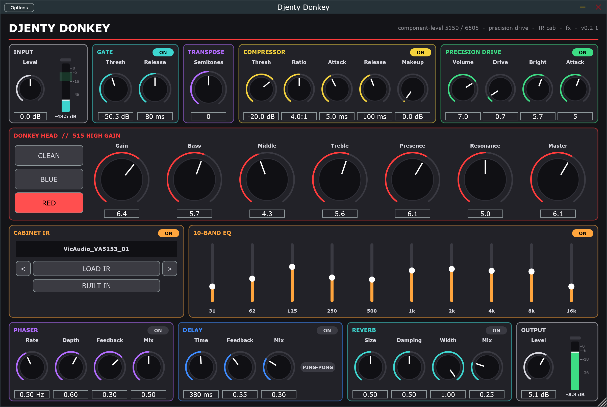

# Djenty Donkey 🫏

**A component-level high-gain guitar amp plugin** — 5150 / 6505-style preamp solved circuit-by-circuit, Precision Drive– and TS9-style pedals, IR loader and effects. VST3 + standalone for Windows.



> 5150, 6505, Peavey, EVH, Horizon Devices, Precision Drive, Ibanez and Tube Screamer are trademarks of their respective owners.
> They are only used to describe the circuits that inspired this model. This project is not affiliated with or endorsed by them.

## Download

Grab the latest `DjentyDonkey-x.y.z-Windows.zip` from **[Releases](../../releases)**.

- `DjentyDonkey-Setup-x.y.z.exe` — installer (desktop shortcut + VST3)
- `Portable/` — no install needed
- No VC++ runtime required

Windows SmartScreen may warn because the exe is not code-signed: click *More info → Run anyway*.

## Signal chain

```
Input ─ Gate ─ Transpose ─ Compressor ─┬─ [8x oversampled] ───────────────────────────────┐
                                       │  Drive (PD / TS9) → 5150 preamp → tone stack → power│
                                       └──────────────────────────────────────────────────┘
      ─ Cabinet IR ─ 10-band EQ ─ Phaser ─ Delay ─ Reverb ─ Output
```

| Block | What it is |
|---|---|
| **Preamp** | Each 12AX7 stage is solved per sample (Koren triode model + Newton–Raphson): coupling caps, cathode bypass caps, grid current and Miller capacitance are real circuit elements, so cold-clipper bias shift ("blocking distortion") happens naturally. In every channel the whole preamp (V1A → V5A with every network between them) is solved as one circuit, so each stage loads the ones next to it: that sets the even harmonics at the edge of breakup and the cold clipper's bias shift (matches LTspice within 0.1 % and ~0.5 dB H2 at every plate). Knob moves ramp across each host block and are smoothed (~20 ms): no zipper noise at any buffer size. |
| **Channels** | Relay positions read off the factory schematic. **RED** = 5150 lead (V1A→V1B→V2A→V2B→V5B→V5A, C26 through R18 for a tight low end). **BLUE** = rhythm with crunch (R43 ‖ C13 gain network, R20 at V2A). **CRUNCH** = BLUE's own pushbutton (relay K4): off gives the 6505's rhythm channel without crunch, still through all five stages (R19 ‖ C51 and the R23 / C63 shunt), switched click-free like a channel. **CLEAN** = 6505 rhythm, *optimized*: bypasses V2A–V5A for headroom (not in the original amp). **BRIGHT** = the rhythm channel's own pushbutton (S1C shorts R75, putting C10 470p across R21), independent of crunch as on the 6505; on by default. **NOISE** (off by default) = the preamp's own noise from physics: every grid-network resistor's thermal noise solved in the circuit, each tube's shot and flicker noise ([docs/noise.md](docs/noise.md)). **TUBES** = Stock (nominal) or one of five fixed sets of real tubes drawn from production spreads (12AX7 current / mu, 6L6 balance between the push-pull sides). Channel switches carry the shared tubes' and capacitors' state over (as the relays do) and crossfade the rewired part over 20 ms: no clicks or thumps. |
| **Tone stack** | The factory network as drawn, including its feed (R89 470k into R24 33k and C59/R94), the 570 pF treble cap, the mid pot wired as a divider and the 500k Post-pot load; solved by nodal analysis, matches LTspice within 0.01 dB. |
| **Drive** | Two pedals to choose from, both solved per sample from their schematics (op-amp + diode clipper with a real JRC4558: 100 dB, 3 MHz): **Precision Drive** (6-position *Attack* cap switch as on the real pedal: 1 = 470n fullest … 6 = 33n tightest; circuit from the public PedalPCB "Dwarven Hammer" build doc) and **TS9** (the classic mid hump; tonepad "El Griton" TS-9 values). Both match LTspice within 0.3 dB small-signal; at clipping the fundamental within 0.1 dB and the odd harmonics within 0.6 dB. Against NAM captures of real pedals the Precision Drive matches within ~0.5 dB (small-signal and guitar spectra) and the TS9 within ~1 dB below 5 kHz; see [docs/precision_drive.md](docs/precision_drive.md). Switching models crossfades over 20 ms. |
| **Power amp** | V3A recovery + long-tail-pair phase inverter + 2×2 6L6GC push-pull + output transformer + 4×12 speaker impedance, solved simultaneously with a nodal DK solver. Presence and Resonance are the real NFB-loop parts (VR9 10k audio taper with C8 ∥ C62, VR8/C12). Flyback diodes, grid current. The 6L6GC model has its datasheet plate resistance (Koren plus an Early term: plate current, gm, rp and screen current within ~1–8 % of the datasheets), and the load is a physical 4×12 of Vintage 30s (Thiele-Small terms from Celestion and a V30-type speaker; box losses fitted within their physical range). Matches LTspice within 0.03 dB small-signal and 0.3 % at clipping, and power-amp-only captures of a real 6505 into three real cabinets within 0.7–0.85 dB rms (160 Hz–5 kHz within ±0.7 dB). |
| **Supply** | Power transformer + bridge rectifier (as on the factory schematic: the reservoir is topped up only near the mains peaks, so B+ carries 120 Hz ripple and sags from 488 V to ~436 V at full power (1 kHz; deeper on low notes)) and the factory chain (reservoir → screen → phase inverter → preamp rails through R59 4k, R60 22k and R61 10k), every node sagging with the real current of the stages it feeds: the preamp sits at ~301 / 317 V and breathes with the power amp. Matches LTspice. |
| **Cab** | Load any `.wav` IR (drag & drop, prev/next in folder) or use the built-in cab. |
| **3-band gate** | Keyed by the clean input, applied after the amp on LR4 bands (300 Hz / 3 kHz): highs close first/fastest/deepest (kills hiss), lows last/slowest/shallowest (keeps the sustain). |
| **Transpose** | *LIVE*: waveform-aligned WSOLA, ~6 ms attack latency. *HQ*: phase-vocoder time-stretch + resampling with identity phase locking and transient phase reset, ~43 ms (reported to the host). Both accurate to a few cents. |

Validation against a real amp: 14 lead and 22 rhythm / crunch [NAM](https://github.com/sdatkinson/neural-amp-modeler) captures of the same Peavey 6505 (various gain / EQ settings; both Gain knobs calibrated on them) — with the knobs at the capture's dial positions the odd harmonics match within ~2–3 dB and the knobs' effect on the spectrum within a fraction of a dB. The 1/3-octave spectra differ by ~2 dB on average, mostly one fixed, knob-independent curve. Its high end (+3 dB) turned out to be a circuit error, not the capture chain: a second, independent chain (power-amp-only captures into real 4x12 / 2x12 cabinets) showed the same, and the Presence network was missing C62 and had a linear instead of an audio taper (fixed). The mid deficit heard against them (−2.3 dB around 1 kHz) came mostly from the power stage following the speaker impedance too much (the 6L6 model had ~30× its datasheet plate resistance); with the datasheet tube and a physical speaker it is −1.3…−1.9 dB against those load-box captures and within ±0.7 dB against real cabinets. The model keeps the factory circuit rather than fitting it. See [docs/nam_calibration.md](docs/nam_calibration.md) and [docs/power_amp.md](docs/power_amp.md).

Validation against LTspice: [docs/spice_reference_lead.md](docs/spice_reference_lead.md), [docs/power_amp.md](docs/power_amp.md), [docs/precision_drive.md](docs/precision_drive.md).
Circuit notes: [docs/5150_schematic_notes.md](docs/5150_schematic_notes.md), [docs/precision_drive.md](docs/precision_drive.md), [docs/gate_and_transpose.md](docs/gate_and_transpose.md).

## Setting the input level

Strum hard and set **Input** so the meter's peak lands in the **green zone (-18 to -6 dBFS)**. The model treats 0 dBFS as 1 V at the guitar jack, which is roughly what real pickups produce.

## Build from source

Requirements: Windows 10/11 x64, **Visual Studio 2022 Build Tools** (Desktop development with C++), **CMake ≥ 3.22**.
JUCE 8.0.4 and the Steinberg ASIO SDK are downloaded automatically by CMake.

```
build.bat
```

Outputs go to `%USERPROFILE%\vab-build\DjentyDonkey_artefacts\Release\` (short path outside `%TEMP%` on purpose: Windows 260-char limit and MSBuild incremental builds).

- DSP regression tests (no JUCE): `%USERPROFILE%\vab-build\Release\dsp_test.exe` (`dsp_test.exe cpu` for per-module CPU)
- Tone regression against the frozen v0.3.0 DSP and a high-precision reference: `%USERPROFILE%\vab-build\Release\tone_regress.exe`
- Package (installer + portable + source zip, needs [Inno Setup 6](https://jrsoftware.org/isinfo.php)):
  `powershell -ExecutionPolicy Bypass -File installer\make_package.ps1`
- LTspice reference netlists: `spice/` (`LTspice.exe -b <file>.cir`)

## Project layout

```
Source/
  dsp/TriodeStage.h     12AX7 stage, Koren model, Newton solver
  dsp/LinearNetwork.h   small MNA solver for R/C networks (tone stack)
  dsp/Preamp5150.h      5150 / 6505 preamp assembled from the schematic
  dsp/TriodeNetwork.h   N triodes + their circuit solved together (DK method, Newton)
  dsp/FullPreamp5150.h  the whole preamp of each channel as one circuit (relay positions), CLEAN's V1A + V1B
  dsp/DKCircuit.h       nodal DK solver (power amp, coupled preamp stages)
  dsp/PowerAmp5150.h    phase inverter + 6L6 power amp + NFB
  dsp/PrecisionDrive.h  drive pedals (Precision Drive, TS9)
  dsp/AmpSim.h          oversampling, power amp, channel trims
  PluginProcessor.*     signal chain, parameters, IR loading
  PluginEditor.*, UI/   interface
  StandaloneApp.cpp     standalone shell (input never muted)
tests/dsp_test.cpp      comparisons against LTspice, fault recovery, CPU benchmark (dsp_test fault / cpu)
tests/nam_compare.cpp   real-amp comparison with NAM captures (--sweep, --fit, --fit-pre)
tests/pedal_compare.cpp drive pedals vs NAM captures of real pedals (--fit, --leg-cap)
tests/power_compare.cpp power amp vs power-amp-only NAM captures: response, compression, bursts (--probe)
tests/tone_regress.cpp  null / band-level comparison vs tests/baseline/ (frozen v0.3.0 DSP)
spice/                  LTspice reference circuits
installer/              Inno Setup script + packaging
```

## Roadmap

- [x] Component-level phase inverter + 4×6L6 power amp with NFB, sag and output transformer
- [x] 3-band noise gate
- [x] LIVE / HQ pitch shifter
- [x] Cathode follower (V3B): checked on the schematic, it sits after the Post pot (FX send), linear at normal Master settings
- [x] Gain / Master / tone path calibrated against NAM captures of a real 6505
- [x] Even harmonics at the edge of breakup vs the real amp (coupled V2B–V5A solve, Gain recalibrated on 14 captures)
- [x] Lead channel: whole preamp solved as one circuit; knob smoothing
- [x] Tone-stack feed network and V5A load as on the factory schematic; preamp B+ supply chain and sag
- [x] V3A recovery stage inside the power-amp circuit, with the 12AX7 interelectrode capacitances (LTspice within 0.05 dB)
- [x] Rhythm / crunch network and relay logic from the factory schematic, BLUE solved as one circuit; click-free channel switching
- [ ] CPU: "eco" mode / hardware port (Raspberry Pi class)
- [ ] Preset browser

## License

**GNU AGPLv3** — see [LICENSE](LICENSE). Built with [JUCE](https://juce.com) (AGPLv3) and the Steinberg ASIO SDK (GPLv3 option); see [installer/THIRD-PARTY-NOTICES.txt](installer/THIRD-PARTY-NOTICES.txt).
ASIO and VST are trademarks of Steinberg Media Technologies GmbH.
